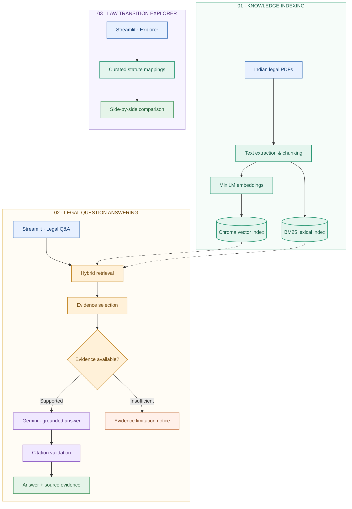

<div align="center">

# LegalBot
### Evidence-aware Indian Legal Information Assistant

**Hybrid Retrieval · Google Gemini · Source Validation · Law Transition Explorer**

**Ask questions about Indian law, inspect the supporting statutory text, and explore changes between older and newer criminal laws.**

[Repository](https://github.com/anushka-cseatmnc/Legal-Bot) · [Original project walkthrough](https://youtu.be/eBlupRjdLZE?si=oIX-Szv4htielN_a)

</div>

> **Educational use only.** LegalBot is not a lawyer or a substitute for professional legal advice. Its indexed documents may not reflect every amendment, notification, or jurisdiction-specific rule. Questions requiring generated explanations are sent to Google Gemini; do not submit confidential or personal case details.

---

## Why LegalBot?

Indian statutes are publicly available, but finding a relevant provision, understanding its language, and checking whether an AI explanation is supported can be difficult. LegalBot combines **searchable statutory evidence** with **natural-language explanations**. Instead of presenting a fluent answer alone, it makes the underlying document, provision, and PDF page visible to the user.

The project explores a practical engineering question: **How can an LLM-based legal assistant remain useful while being transparent about the evidence behind its answers?**

## What it does

| Capability | Description |
|---|---|
| **Evidence-grounded Q&A** | Retrieves relevant passages and generates concise explanations anchored to the indexed documents. |
| **Hybrid search** | Combines semantic retrieval (MiniLM embeddings + Chroma) with BM25 lexical retrieval for legal terminology and section references. |
| **Traceable citations** | Shows source labels, statute/section information where available, and PDF page references; validates generated source references against retrieved evidence. |
| **Conversational follow-ups** | Retains enough context to interpret follow-up questions such as “What if it happens a second time?” |
| **Evidence-aware responses** | Can identify incomplete support and decline to invent answers or source references. |
| **Law Transition Explorer** | Provides curated comparisons across **IPC → BNS**, **CrPC → BNSS**, and **IEA → BSA** with statutory excerpts. |
| **Cloud-oriented inference** | Uses the Google Gemini API instead of requiring a locally hosted 7B language model at runtime. |

### Example: an answer users can verify

**Question:** What is the punishment for theft under BNS Section 303?

**Answer:** Section 303(2) provides for imprisonment up to three years, a fine, or both for theft. A second or subsequent conviction carries rigorous imprisonment of one to five years and a fine. The subsection also includes a community-service proviso for qualifying first-time theft involving property worth less than ₹5,000, subject to return or restoration of the property.

**Evidence shown:** *Bharatiya Nyaya Sanhita, 2023 · Section 303(2) · PDF page 79.*

The UI displays the statutory passage so users can compare the explanation with its source. This example is illustrative of a tested response, **not a guarantee of correctness for every question**.

## System architecture

LegalBot separates **document indexing** from **question answering**. The diagram uses a compact top-to-bottom layout with short labels so it stays readable on GitHub and on smaller screens.



**Reading the diagram:** The **green indexing pipeline** prepares reusable legal evidence; the **amber retrieval pipeline** selects passages for a question; the **purple generation stage** creates and checks a cited explanation. The Law Transition Explorer is an independent feature using curated statute mappings. Dotted arrows indicate that retrieval reads from the prebuilt indexes rather than regenerating them per request.

**Design rationale:** Semantic retrieval helps with natural-language questions; BM25 helps preserve exact legal terms and section identifiers. The answer generator receives selected source passages rather than relying solely on model memory. Citation checks help detect unsupported references, although they do not establish that every legal interpretation is correct.

## Technology stack

| Layer | Technology | Role |
|---|---|---|
| Interface | Streamlit | Interactive Q&A, source display, law comparisons |
| Language model | Google Gemini (`google-genai`) | Hosted answer generation |
| Embeddings | Sentence Transformers / MiniLM | Local dense query and document embeddings |
| Vector retrieval | Chroma | Persistent semantic index |
| Lexical retrieval | BM25 | Exact-term and statute-oriented matching |
| Retrieval orchestration | Python | Evidence selection, context assembly, routing |
| Validation | Source-ID and quotation checks | Rejects fabricated or unsupported references |
| Testing | Python `unittest` | Retrieval, interface, provider, and integration checks |

## Knowledge base and coverage

The newer project snapshot discussed during development uses **27 Indian legal PDFs** and a prebuilt index of approximately **21,971 chunks**. Coverage includes criminal law and procedure, evidence, marriage, rights, and other selected legal topics. This is a **curated collection, not an exhaustive or continuously updated database of Indian law**.

The Law Transition Explorer contains curated mappings and statutory excerpts for selected transitions between older and newer criminal-law frameworks. It is a comparison aid, not a comprehensive concordance of every provision.

> **Version awareness:** A PDF's presence in the corpus does not establish that it is the latest authoritative version. Check official legislation, amendments, commencement dates, and applicable jurisdiction before relying on a provision.

## Run locally

> These instructions target the **newer cloud-oriented codebase**. The public `main` branch may still contain the legacy Mistral/FastAPI implementation until the updated application code is pushed.

### 1. Clone and install

```bash
git clone https://github.com/anushka-cseatmnc/Legal-Bot.git
cd Legal-Bot
python -m venv .venv
```

Activate the environment:

```powershell
# Windows PowerShell
.venv\Scripts\Activate.ps1
```

```bash
# macOS / Linux
source .venv/bin/activate
```

Install dependencies (in the updated codebase):

```bash
python -m pip install -r requirements.txt
```

### 2. Configure Gemini securely

Create `.streamlit/secrets.toml`:

```toml
[legalbot]
api_key = "YOUR_GEMINI_API_KEY"
```

Obtain a key from [Google AI Studio](https://aistudio.google.com/api-keys). **Keep the quotes around the value.** Never commit `secrets.toml` or share the key in screenshots, issues, or logs. The application requires the compatible prebuilt index bundle and checksum (or an explicitly configured index source) in the expected deployment location.

### 3. Start the app

```bash
python -m streamlit run streamlit_app.py
```

Open the local address printed by Streamlit. The newer architecture does **not** require a separate FastAPI server or a locally hosted Mistral model.

## Deployment

The application is designed for a lightweight Streamlit frontend with hosted Gemini inference and a precomputed retrieval index. Before publishing:

1. Push the **updated cloud-oriented application code**, `requirements.txt`, and Streamlit entry point to the deployment branch.
2. Make the prebuilt index bundle and its matching SHA-256 checksum accessible using the application's supported configuration. Do not assume a local, untracked ZIP will exist in a fresh cloud instance.
3. Configure `[legalbot]` → `api_key` in the deployment platform's **secret settings**, not in Git.
4. Set the entry point to `streamlit_app.py` and verify startup from a clean environment.
5. Test grounded Q&A, contextual follow-ups, Law Transition Explorer, and provider-error handling on the public URL.

**Live application:** *Add the deployment URL after the public app is online and verified.*

## Evaluation and engineering checks

The latest reported development run completed **46 automated tests**, including retrieval, citation validation, and Law Transition Explorer checks. A separate live Gemini verification completed a three-turn Streamlit conversation: BNS Section 303, its repeat-conviction follow-up, and a Hindu Marriage Act question. One transient HTTP 504 occurred on an earlier attempt before a retry succeeded.

| Scenario | Observed behavior |
|---|---|
| BNS §303 theft penalty | Grounded answer with source citation |
| Repeat-conviction follow-up | Contextual answer referencing the same provision |
| Hindu Marriage Act §5 | Partial answer; incomplete evidence was disclosed |
| Unrelated machine-learning question | Insufficient evidence |
| Current GST threshold question | Insufficient evidence without supported documents |
| Fabricated BNS §999 | No invented section or penalty |

These are **reported development checks**, not a formal benchmark of legal accuracy or production availability. In particular, the incomplete Hindu Marriage Act response illustrates why retrieval completeness matters alongside hallucination control.

## Limitations and responsible use

- **Not legal advice.** Do not use generated answers as a substitute for a qualified legal professional.
- **Limited coverage.** The corpus may not contain the requested law, amendment, state rule, or notification.
- **Not necessarily current.** Applicability and commencement dates require authoritative verification.
- **Hosted processing.** Questions requiring generated explanations are sent to Google Gemini; avoid personal, sensitive, or confidential facts.
- **Possible errors.** Retrieval, interpretation, provider availability, and citation validation can all fail. A citation establishes traceability to a retrieved passage, not guaranteed legal correctness.

## Future direction

The architecture is intended to support further development, **not to imply these features are already shipped**:

- Broader ingestion from authoritative Indian legal sources, with reviewed updates.
- Amendment-aware and effective-date-aware statute versions.
- More complete section-level retrieval across multi-page provisions.
- An explicitly labeled **general AI information** mode when indexed evidence is unavailable, separate from verified legal answers.
- Expanded evaluation for citation fidelity, coverage, retrieval completeness, and unsupported claims.

## Project evolution

LegalBot began as an offline legal RAG prototype using local inference. The newer design replaces heavyweight local generation with a hosted model, emphasizes traceable statutory evidence, and adds a dedicated law-transition experience. The central objective remains the same: **make legal information easier to navigate without hiding the limits of the underlying evidence.**

## Author

**Anushka Chaudhary**  
Integrated M.Tech in Artificial Intelligence · VIT Bhopal University  
[GitHub](https://github.com/anushka-cseatmnc)

---

<div align="center"><sub>LegalBot · Indian legal information with visible sources · For educational use only</sub></div>


